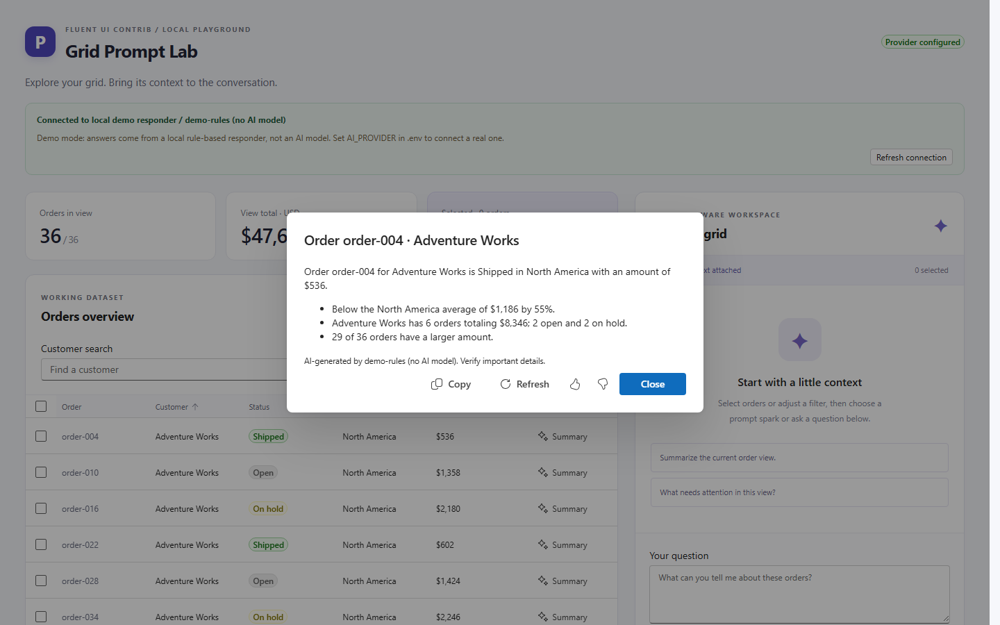

# Grid Assistant

AI row summaries and prompt components for Fluent UI v9 data grids. Click
**Summary** on a grid row, get a short AI-written overview with highlights, then
copy it, refresh it, or rate it, like the
[row summaries in Power Apps model-driven apps](https://learn.microsoft.com/en-us/power-apps/user/record-summaries).



- **Works with any AI model.** The backend sends a JSON prompt and expects JSON
  back, so OpenAI, Azure AI Foundry, GitHub Models, local models (Ollama, LM
  Studio, vLLM), or your own Copilot-style gateway all plug in through settings.
- **Prompts come from context, not config.** The server builds each prompt from
  the table, column metadata, the record, and computed facts about related
  records. No prompt text lives in a config file, environment variable, or the
  browser.
- **Plus the original components:** Prompt Sparks and Prompt Gallery collect
  structured prompts and explicit grid context; your application owns data
  access and AI calls.

## Run the demo (no AI account needed)

Requires Node **22.18+** (or Node 24+) and npm. From this repository's root:

```powershell
npm.cmd ci
npm.cmd run demo
```

Open **http://127.0.0.1:5187**, click **Summary** on any row, and try Prompt
sparks. Demo mode uses a clearly labeled local rule-based responder
(`demo-rules`) instead of a model, so it works offline. It restates the supplied
context, so use a real provider to judge summary quality. The API runs at
**http://127.0.0.1:3017**. Both bind to loopback only; stop with Ctrl+C.

On macOS or Linux, use `npm` instead of `npm.cmd`.

## Connect a real AI model

Copy `examples/playground/.env.example` to `examples/playground/.env`, set the
provider, then run `npm.cmd run dev`:

| Target | `AI_PROVIDER` | `OPENAI_BASE_URL` | `AI_AUTH_SCHEME` |
|---|---|---|---|
| OpenAI | `openai-compatible` | `https://api.openai.com/v1` | `bearer` |
| Azure AI Foundry / Azure OpenAI (v1 API) | `openai-compatible` | `https://<resource>.openai.azure.com/openai/v1` | `bearer` or `api-key` |
| GitHub Models | `openai-compatible` | `https://models.github.ai/inference` | `bearer` |
| Local (Ollama, LM Studio, vLLM) | `openai-compatible` | `http://127.0.0.1:11434/v1` | `none` |
| Copilot or custom gateway | `json-http` | your gateway URL | `bearer`, `api-key`, or `none` |

Also set `OPENAI_MODEL` (model or deployment name) and, for remote endpoints,
`OPENAI_API_KEY`. Credentials stay in the backend and are never returned to the
browser. Never commit `.env`. See the [example guide](examples/playground/README.md)
for the JSON contract and privacy notes.

## How a row summary works

```text
Summary click -> POST /api/summary { rowId }
  -> server builds context (table, columns, record, related facts)
  -> prompt generated from that context -> provider adapter (JSON in)
  -> provider replies { summary, highlights } (JSON out) -> validated -> dialog
```

Row summaries send that one record's field values to your provider. Review its
data policy before connecting real business data.

## Get started with development

Requires Node **22.18+** (or Node 24+) and npm. From this repository's root:

```powershell
npm.cmd ci
npm.cmd run build
npm.cmd run dev
```

The lockfile pins versions and integrity hashes without machine-specific registry
URLs. npm uses your configured registry (the public npm registry by default).
`dev` serves the same URLs as the demo but uses your `.env`; without a provider,
grid selection, filtering, sorting, prompt sparks, and the gallery still work and
AI actions report an explicit configuration error. Use `npm.cmd run demo`
for a response without configuring anything. Never commit credentials.

## Repository layout

- [packages/react-prompts](packages/react-prompts): editable component source,
  utility and React unit tests, browser component tests, and Storybook examples.
- [examples/playground](examples/playground): React grid integration, local API,
  fictional order data, shared contracts, and end-to-end tests.
- [vendor](vendor): the MIT-licensed virtualized Fluent grid dependency snapshot.

The example is an npm workspace consumer of the local prompt package, not the
old prompt tarball. Its Vite alias loads the package's TypeScript source directly,
so component edits hot-reload with `npm.cmd run dev`. No Contrib checkout, Nx,
Yarn, package-refresh script, or personal filesystem path is required.

## Component development

See the [component API and behavior guide](packages/react-prompts/README.md).
Keep a terminal running `npm.cmd run dev`, then edit
`packages/react-prompts/src`. The public exports remain named
`@fluentui-contrib/react-prompts` for compatibility; this is an independent
repository, not an official package release. Packages are marked private to
prevent accidental npm publication.

```powershell
npm.cmd run build
npm.cmd run lint
npm.cmd test
npx.cmd playwright install chromium
npm.cmd run test:components
npm.cmd run test:e2e
```

- `build` emits the package's JavaScript/declarations and builds the example.
- `test` runs the package's Jest tests and the example's Node API tests.
- `test:components` runs the component's real-browser Chromium tests.
- `test:e2e` starts and stops its own example servers; stop `dev` first.
- `npm.cmd run storybook` opens the standalone examples on
  **http://127.0.0.1:6006**, without calling an AI provider.

The example backend is for local development, not authenticated production
hosting. Read its guide before connecting real business data or exposing it.

## Attribution and license

The component and grid dependency were extracted from the local
[Fluent UI Contrib](https://github.com/microsoft/fluentui-contrib) development
checkout, including local component additions. This repository starts with a
fresh history; it does not claim that those additions were released upstream.
Existing Microsoft copyright and MIT terms are retained in [LICENSE](LICENSE).
See [vendor/README.md](vendor/README.md) for the bundled dependency's provenance.
